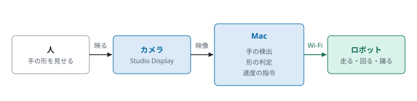
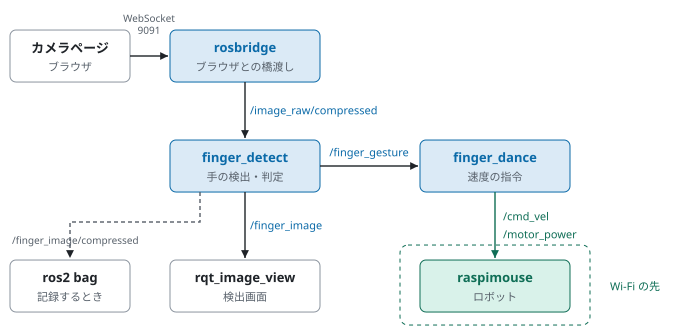

# chibariyo-dance-mimic

指の動きや人のダンスに合わせて、Raspberry Pi Mouse を走らせる・踊らせる ROS 2 のシステムである。カメラの映像から MediaPipe で手や体の点を求め、その動きをロボットの速度の指令に変える。伴走型スマート車いす「チバリヨカー」で同じことをするための前段として、まず Raspberry Pi Mouse で作った。

| 機能 | 入力 | ロボットの動き |
|---|---|---|
| 指ダンス（finger_dance） | 手の形と人差し指の向き（MediaPipe Hand Landmarker） | 人差し指の向きで前進・旋回・後退、チョキで踊る、グー・パーで止まる |
| ダンスの物真似（pose_dance） | 人の体の 33 点（MediaPipe Pose Landmarker）。カメラの前の人、またはダンスの動画 | 体の向きと腰の揺れで向きを変え、腰の上下で前後に揺れ、手を上げると LED が点く |

## デモ

- [media/finger_dance_robot.mp4](media/finger_dance_robot.mp4)：指の向きで Raspberry Pi Mouse を操作する（左：ロボット、右：手の検出）
- [media/dance_mimic_man.mp4](media/dance_mimic_man.mp4)：ダンス動画に合わせて踊る（左：ロボット、右：体の検出）
- [media/dance_mimic_hiphop.mp4](media/dance_mimic_hiphop.mp4)：ヒップホップの動画に合わせて踊る
- [media/dance_mimic_turtlesim.mp4](media/dance_mimic_turtlesim.mp4)：turtlesim の亀で確かめた様子

## 仕組み



PC（Mac）の Docker コンテナで ROS 2 Jazzy を動かし、手や体の検出と速度の指令の計算を行う。ロボット（Raspberry Pi Mouse V3 ＋ Raspberry Pi 3）には、Wi-Fi で速度の指令だけを送る。コンテナとロボットの間は rmw_zenoh でつなぐ。カメラの映像はブラウザのページ（`camera.html`）から rosbridge でコンテナに送る。



詳しくは次の 2 つの書類にまとめた。

- [設計書](docs/設計書.pdf)：構成、データの流れ、手の検出と判定、速度の指令への変換、パラメータ、設計上の考慮点
- [操作手順書](docs/操作手順書.pdf)：起動・操作・終了の手順、turtlesim での確認、動画の作り方、うまくいかないとき

## フォルダの中身

| フォルダ | 内容 |
|---|---|
| `ros2_ws/src/finger_dance/` | ROS 2 のパッケージ。指ダンス（`finger_detect.py`、`finger_dance.py`）とダンスの物真似（`video_source.py`、`pose_detect.py`、`pose_dance.py`）。対応の計算は ROS 2 に依存しない `hand_shape.py`、`mapping.py`、`pose_mapping.py` にまとめた |
| `docker/` | コンテナ（Ubuntu 24.04、ROS 2 Jazzy、MediaPipe）の `Dockerfile` と `compose.yaml`、実機との接続コマンド `robot.bash`、カメラページ `camera.html` |
| `chibamouse/` | ロボットの SD カードの作り方と、名前・Wi-Fi を設定するスクリプト |
| `ros2_ws/tools/`、`tools/` | 記録を MP4 にする道具、ロボットの動画と検出画面を並べる道具、ダンス動画のダウンロード |
| `ros2_ws/analysis/` | ダンス動画の体の動きの分析と、ロボットの動きの試算 |
| `docs/` | 設計書・操作手順書（HTML と PDF）、図（`make_figures.py` で作る）、作業記録 |
| `media/` | デモ動画 |

## 試し方（turtlesim）

```bash
cd docker && docker compose up -d --build
```

ブラウザで http://localhost:6081 を開き、デスクトップの Terminator で次を実行する。

```bash
cd ~/ros2_ws && colcon build --symlink-install && source install/setup.bash
ros2 launch finger_dance finger_dance.launch.py turtlesim:=true   # 指ダンス
```

指ダンスでは、ブラウザで http://localhost:6081/camera.html?port=9091 を開いてカメラの映像を送る。ダンスの物真似は、先にダンス動画を `tools/download_videos.sh` で `ros2_ws/videos/` に取ってから起動する。

```bash
ros2 launch finger_dance pose_dance.launch.py turtlesim:=true
```

実機での手順は[操作手順書](docs/操作手順書.pdf)にある。

## 使わせていただいたもの

- ダンス動画（Pexels、[Pexels License](https://www.pexels.com/license/)）：Antoni Shkraba「Video of a Man Dancing」「Woman Dancing」、Pavel Danilyuk「A Woman Dancing Gracefully」、cottonbro studio「Woman Dancing in Hip Hop Style」「Man Dancing Hip Hop」、Yaroslav Shuraev「A Woman Freestyle Dancing」。動画そのものはこのリポジトリに入れず、`tools/download_videos.sh` で Pexels から取る
- 手の写真（`docs/img/point_*.jpg`、`peace*.jpg`、`fist*.jpg`）：MediaPipe の試験用画像（Apache License 2.0）に、このシステムの検出結果を描いたもの
- MediaPipe（Apache License 2.0）、ROS 2、rmw_zenoh、rosbridge、Raspberry Pi Mouse のソフトウェア（RT Corporation）

## ライセンス

MIT License（[LICENSE](LICENSE)）
